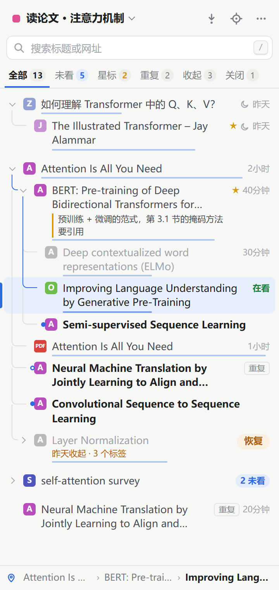
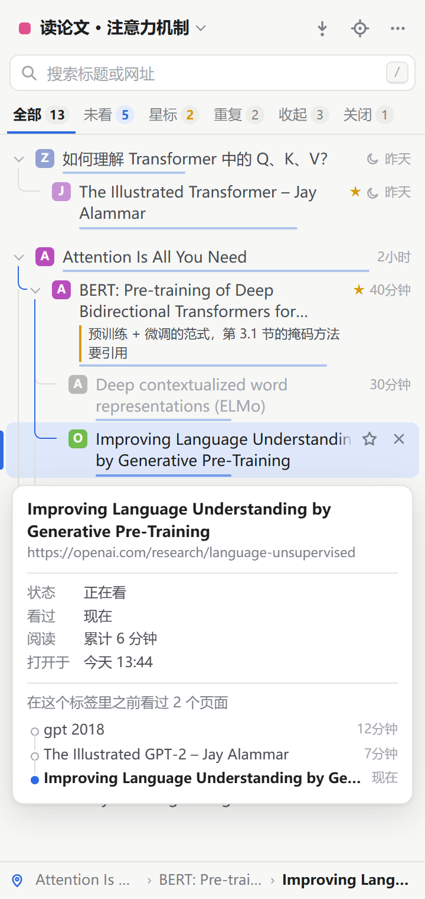
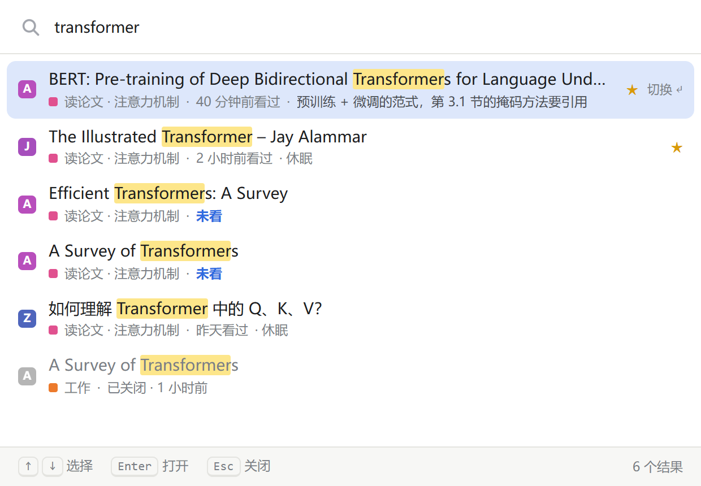

<div align="center">


# 标签脉络 Tab Trail

**把浏览器标签按「从哪个页面打开的」整理成一棵树：记录每篇看没看过、什么时候看的、看了多久。**

支持 Chrome · Edge · Firefox ｜ 数据只存在本机 ｜ [English](README.en.md)

</div>

<p align="center">
  
  &nbsp;
  
</p>

## 为什么做这个

标签一多，浏览器自带的标签栏就不够用了：横着放，标题被挤没；竖着放，也只是一长串列表。更麻烦的是，标签之间本来是有关系的。比如读文献：A 里引用了 B、C、D，看完 B 又点开了 E、F、G，看完 F 之后，就不知道 C 和 D 在哪了，也说不清哪篇看过、是什么时候看的。

标签脉络不替换浏览器原来的标签栏，而是在侧边栏里提供一棵「阅读树」：

| 痛点 | 插件怎么做 |
|---|---|
| 标签太多，标题被挤没了 | 侧边栏里显示完整标题，自动去掉「- 知乎」「_哔哩哔哩」这类网站名；按 `Alt+K` 在任何页面快速搜索 |
| 几个任务混在一起 | 一个窗口对应一个**工作区**，可以命名、切换、整个收起，以后再恢复 |
| 看文献时理不清先后关系 | 按「从哪个页面打开的」自动建树；记录看没看过、什么时候看的、看了多久；**「下一篇未看」**按树的顺序带你去还没看的那篇 |
| 想先收起一批，过几天再看 | 右键一个分支选「收起」，标签关掉但记录留在树上，之后一键按原来的结构恢复 |

## 功能一览

- **阅读树**：Ctrl+点击或中键打开的链接，自动挂在来源页面下面；树形连线，当前标签所在的路径用蓝色高亮
- **阅读记录**：未看的有蓝点；右侧显示多久前看过；底部细条显示读了多久；同一个标签里点链接跳转的页面也会记下来
- **找得到**：搜索标题、网址、备注和跳转过的页面；`Alt+K` 快速搜索框；筛选「未看 / 星标 / 重复 / 收起 / 关闭」；底部显示当前位置
- **整理**：拖动调整树的结构；移到别的工作区；收起和恢复分支或整个工作区；复制标签；重复标签提醒；星标和备注
- **并排看**：两个标签用浏览器自己的分屏，三个到六个合到同一页，可以调大小、放大一格、随时拆开
- **省内存**：太久没看的标签自动休眠（释放内存，标签不关）
- **带得走**：把一个分支或整个工作区导出成 Markdown 清单或浏览器书签文件
- **不怕丢**：关掉的标签留在树上 30 天；关闭窗口等于收起工作区；浏览器重启后按网址接回原来的位置
- 浅色和深色主题、紧凑显示、三档字号

<p align="center">
  
</p>

## 安装

目前还没有上架应用商店，需要手动加载（只需几步，不用安装任何开发工具）。

先下载：到 **[Releases 页面](https://github.com/t44460298-dotcom/tab-trail/releases/latest)** 下载最新的 `tab-trail-v*.zip`，右键 →「全部解压缩」，放到一个固定的位置（加载后不要删除或移动这个文件夹）。

### Chrome / Edge

1. 地址栏打开 `chrome://extensions`（Edge 打开 `edge://extensions`）
2. 打开「开发者模式」（Chrome 在右上角，Edge 在左侧）
3. 点「加载解压缩的扩展」，选择解压出来的文件夹（里面直接就是 `manifest.json`）
4. 点工具栏上的拼图图标，把「标签脉络」固定到工具栏

### Firefox

1. 地址栏打开 `about:debugging#/runtime/this-firefox`
2. 点「临时载入附加组件」，直接选下载的 zip 文件（或者解压后的 `manifest.json`）

### 升级

把新版本解压后**覆盖到原来的文件夹**，再到扩展管理页点一下插件卡片上的刷新按钮。记录保存在浏览器里，不会丢。

> 一定要覆盖原来的文件夹。Chrome / Edge 是按文件夹位置区分插件的，换一个位置加载，会被当成另一个插件，原来的记录就看不到了。

想用还没发布的最新代码：点这个页面上方绿色的 **Code → Download ZIP** 下载源码，加载时选其中的 `extension` 文件夹。

> Firefox 用这种方式加载的插件，**重启浏览器后会消失**。想长期使用，可以把插件提交到 addons.mozilla.org 做「自行分发」签名（免费，不会公开上架）。也可以改用 Firefox Developer Edition，在 `about:config` 里把 `xpinstall.signatures.required` 设为 `false`。
>
> 加载时会看到几条 `sidePanel`、`favicon`、`side_panel` 之类的警告，这些是 Chrome 专用的配置，Firefox 会忽略，不影响使用。

需要 Chrome / Edge 121 或 Firefox 121 以上的版本。

## 使用

- **打开侧边栏**：点工具栏上的图标，或者按 `Alt+Shift+Q`。快捷键可以在 `chrome://extensions/shortcuts` 里修改
- **快速搜索（`Alt+K`）**：在任何页面（包括 PDF 和浏览器设置页）按 `Alt+K`，屏幕中间会弹出一个搜索框：
  - 什么都不输入：列出最近看过的标签，直接回车就回到上一个标签
  - 输入关键词：在所有工作区里搜，包括打开中、已收起、已关闭的标签，备注，以及标签里跳转过的页面
  - `↑` `↓` 选择，`Enter` 打开（已关闭的会重新打开），`Esc` 或点别处关闭
- **让树长出来**：在网页里用 **Ctrl + 点击** 或 **鼠标中键** 打开链接，新标签会自动挂在来源页面下面
- **看懂每一行**：
  - 标题左边有蓝点、文字加粗：还没看过（停留超过 1.5 秒才算看过）
  - 左边有蓝条、右侧显示「在看」：正在看的这一篇
  - 右侧的小字：多久前看过（如「40分钟」「昨天」）
  - 灰色：已关闭或已收起。点一下就在原位置重新打开
  - 折叠的分支右侧会显示「+5」；如果里面还有没看的，会变成蓝色的「2 未看」
  - 鼠标停在一行上一会儿，会弹出卡片，显示完整标题、网址、什么时候看的、累计读了多久
  - 树上的连线表示「从哪个页面打开的」，从最上层一直到当前标签的那条路径是蓝色的
  - 「重复」小标签：同一个网页还开在别处，点它跳过去
  - 空心蓝点：这个标签还没看，但同一个网页以前在别处看过
  - 红色 PDF 图标：PDF 文件。arXiv 的 PDF 会自动用论文标题代替文件名
- **网页标题会自动精简**：去掉「- 知乎」「_哔哩哔哩」「- YouTube」「[1706.03762]」这类网站名和编号，省出地方给真正的标题。悬停卡片里仍是完整的原标题；不想要可以在「更多」菜单里关掉
- **同一个标签里点链接跳转**：跳走之前的页面会记下来（后退会自动撤回，只改 `#锚点` 不算）。悬停卡片里能看到「一路是怎么点过来的」；右键菜单里可以把其中某一页在新标签里重新打开，新标签会挂在这个标签下面；搜索也能搜到这些页面
- **重命名**：右键 →「重命名」，或选中一行后按 `F2`，标题会变成输入框，回车保存。新名字会显示在侧边栏、`Alt+K` 搜索框和导出的清单里，新名字和原标题都能搜到；悬停卡片里仍能看到原标题。清空名字或右键 →「恢复原标题」就改回去。只在插件里显示，不改浏览器标签栏上的名字。名字属于这个网页：在这个标签里跳到别的网页时不会带过去，后退回来会恢复
- **复制标签**：右键 →「复制标签」，或选中一行后按 `D`。和浏览器自带的复制一样，前进后退记录也带上。副本和原标签同一级，排在它后面，名字和跳转记录一起带上，不算「重复」；在副本里跳到别的网页后就是一个普通标签了
- **并排显示**：
  - **两个标签**：右键一行 →「和当前标签并排」。Chrome / Edge 用的是浏览器自己的分屏：标签还是原来的标签，页面不用重新加载，任何网站都能用。右键其中一个 →「取消并排」就分开了
  - **选几个一起**：右键一行 →「选几个一起并排…」，或按住 `Ctrl` 点一行，再点其他行（最多 6 个），最后点底部的「并排显示」。选 2 个用分屏；3 个以上（分屏一组只能放两个）合到一个**并排页**
  - **并排页**：可以排成左右、上下或网格，拖动缝隙调大小，双击标题放大一格。每一格能刷新（↻）、变回单独的标签（↗）、拿掉（×）；「全部拆开」把每一格都变回单独的标签。在格子里点链接，格子就跟着跳，变回单独的标签时打开的是现在这一页
  - **合并时**：原来的标签会关掉，免得同样的页面加载两遍。页面会重新加载，**没提交的输入内容和滚动位置不会保留**。它们留在树上，标着「并排」，点一下就跳到并排页。关掉并排页时，它们算已关闭，同样能在树上重新打开
  - **第一次显示某个网站**要点一次「允许」，之后不再问（也可以一次允许所有网站）。允许过的网站可以在 `chrome://extensions` 的插件详情里看到和收回。不允许也会试着打开，有些网站本来就不限制
  - 同一网站的格子一个接一个加载，以免被网站限制；不在看的并排页先不加载
- **星标和备注**：鼠标移到一行上点 ☆，或选中后按 `S` 加星标；右键选「写备注」，在这一行里直接写一句话，回车保存（双击备注可以修改）。备注能被搜索到；加了星标或备注的记录不会被自动清理
- **休眠**：太久没看的标签会自动「休眠」：释放内存，但标签还在标签栏里，点开时重新加载。休眠中的标签右侧有个月亮图标
  - 默认 2 小时没看就休眠，可以在「更多」菜单 →「自动休眠」里改成 30 分钟 / 1 小时 / 6 小时，或者关掉
  - 正在看的、固定的、正在播放声音的标签不会休眠
  - 也可以手动：右键一个分支选「让这个分支休眠」，或在「更多」菜单里选「让其他标签都休眠」
  - 注意：休眠的标签重新加载时，没提交的表单内容可能会丢。正在填写重要内容的页面，可以先固定（右键标签 →「固定」）
- **拖动调整树**：按住一行拖到另一行上：
  - 拖到上沿（出现蓝线）= 放在它前面；拖到下沿 = 放在它后面
  - 拖到中间（出现蓝框）= 变成它的子节点
  - 拖到树下面的空白处 = 移到最上层
  - 不能拖进自己的分支里。手动调整过的位置会一直保留
- **移到别的工作区**：右键 →「移到工作区」，选一个打开中的工作区（标签会挪到那个窗口），或一个收起的工作区（标签关掉，记录放进去，恢复那个工作区时一起打开），或「新工作区」（开一个新窗口）。默认连同下面的分支一起移，可以在菜单里取消勾选「连同下面 N 个一起移」。右键 →「移到最上层」可以让它脱离上级
- **导出**：右键一个分支 →「导出这个分支」，或「更多」菜单 →「导出这个工作区」：
  - 复制为 Markdown：带层级和链接，看过的打 `[x]`，没看的是 `[ ]`，还有星标、备注、阅读时长，粘贴到 Obsidian、Typora、语雀等笔记软件里就是一张清单
  - 下载 Markdown 文件（`.md`）
  - 下载书签文件（`.html`）：在任何浏览器的「导入书签」里选它，就能导成书签文件夹，有子节点的会变成子文件夹
- **阅读时长条**：每行底部一条很细的蓝线，读得越久越长，一眼看出哪几篇花的时间最多（可在「更多」菜单里关掉）
- **字号**：「更多」菜单 →「字号」，有小、中、大三档
- **顶部的筛选**：「全部 / 未看 / 星标 / 重复 / 收起 / 关闭」。比如点「未看」，只列出还没看的标签（上级页面淡色显示，方便看出它们挂在哪里）。筛选项放不下时，可以用滚轮左右滚动
- **底部的位置条**：显示当前标签在树上的路径，比如「Attention › BERT › GPT」。点哪一段就在树上定位到哪一篇
- **下一篇未看**：点顶部的 ↓ 按钮，或在侧边栏里按 `N`。比如看完 F，它会依次带你去 G、C、D
- **搜索**：按 `/` 聚焦搜索框，`↑` `↓` 选择，`Enter` 打开，`Esc` 清空
- **键盘**：`↑` `↓` 选择一行，`←` `→` 折叠或展开，`S` 加/取消星标，`F2` 重命名，`D` 复制标签
- **右键菜单**：复制标签、并排、加星标、重命名、写备注、标为已看/未看、收起/另存为一组/休眠/关闭整个分支、移到工作区、移到最上层、导出、复制链接、从记录中删除
- **「更多」菜单**（右上角 `⋯`）分三组：
  - 显示：紧凑显示（标题只占一行）、字号、精简网页标题、阅读时长条、是否显示已关闭的记录
  - 整理：全部折叠/展开、让其他标签都休眠、关闭重复的标签（每个网页留一个：正在看的优先，否则留最早打开的）、导出这个工作区、清空已关闭的记录
  - 设置：自动休眠
- **工作区**：点左上角的工作区名称，可以切换、新建、重命名、收起。每个工作区有自己的颜色。**直接关闭窗口，也等于把这个工作区收起**，不会丢记录
- **保存多组标签，下次挑一组打开**：
  - 右键一棵树 →「**另存为一组…**」，起个名字，这棵树的标签就关掉、存起来了。收起工作区、直接关窗口或关浏览器，也会自动存起来
  - 点顶部的**书签按钮**（右上角数字是保存了几组），进入「已保存的工作区」：每组一张卡片，能看到名字、标签数、保存时间和里面的主要内容，可以打开、改名、导出、删除，搜索框也能搜。**点卡片里的某一棵树，就只打开那一棵**，其余的继续收着
  - **打开时不会卡**：一组里不管有多少标签，只有你最近看的那一篇马上加载，其余的标签会出现在标签栏里（显示原来的标题和图标），选中时才加载。侧边栏里这些标签右侧有个月亮图标，表示还没加载。恢复收起的分支也是这样
  - **不容易被网站拒绝**：有些网站不允许同时加载太多页面（比如提示「你同时打开的页面较多」）。所以没加载的标签要选中并停留一小会儿（0.35 秒）才开始加载，快速点过去的不会加载；同一网站的页面一次只加载一个，等前面的加载完再开始（最多等 15 秒）；从休眠里点醒的标签，还没加载完就切走的话，会接着睡，把名额让出来
  - 这些还没加载的标签是普通的网页，不依赖插件：刷新或升级插件时不会被关掉，卸载插件后也还在，点里面的链接就能打开
  - 新开一个窗口时（里面只有新标签页），侧边栏会直接列出保存的组，点一组就**在这个窗口里**打开，不会再多开一个窗口
  - 想每次自己挑一组打开，就把浏览器的「启动时继续上次的标签」关掉（Edge：`edge://settings/startHomeNTP`；Chrome：`chrome://settings/onStartup`，选「打开新标签页」）；想重启后全部接着用，就打开它
- **误关了标签**：用 `Ctrl+Shift+T` 重新打开，它会回到树上原来的位置

## 数据与隐私

- **不联网，不收集任何数据。** 所有记录只保存在你自己浏览器的 `storage.local` 里，卸载插件时一起删除
- 已关闭的记录保留 30 天后自动清理；已收起的、加了星标或备注的不会自动删除
- 浏览器重启后会按网址把恢复出来的标签接回原来的节点。如果没有恢复，这些标签会变成「已收起」，可以手动恢复

申请的权限和用途：

| 权限 | 用来做什么 |
|---|---|
| `tabs` | 读取标签的标题、网址和打开关系，用来建树 |
| `storage`、`unlimitedStorage` | 把阅读记录存在本机；标签多的时候不受 10MB 限制 |
| `alarms` | 每 5 分钟检查一次，让太久没看的标签休眠 |
| `sidePanel` | 在 Chrome / Edge 的侧边栏里显示 |
| `favicon` | 在 Chrome / Edge 里显示网站图标（包括已关闭的标签） |
| `webNavigation` | 知道并排页的每一格现在跳到了哪个网页 |
| `declarativeNetRequestWithHostAccess` | 让并排页能显示「不许被嵌入」的网站：只在并排页这个标签里、只对格子里的网站，去掉 `X-Frame-Options` 和 `Content-Security-Policy` 响应头 |
| 访问网站（可选，用到时才询问） | 上面这条规则要你允许过这个网站才生效。插件不注入脚本、不读取网页内容，也不访问你没打开的网站。浏览器的提示写的是「读取和更改你在某网站上的数据」，那是它对这项权限的固定说法 |

## 已知限制

- **并排页里的网站少了一层保护**：为了能显示，这些网站在并排页里没有 `Content-Security-Policy`（网站用来防范恶意脚本的规则）。网银、支付这类重要网站，请单独打开，不要放进并排页
- **并排页不是所有网站都能用**：有些网站（比如部分登录页、网银）发现自己被嵌入就会变成空白或拒绝登录，这时点 ↗ 单独打开。这是网站自己的代码在拦，插件没法绕过
- 并排页里的 `target=_top` 链接点了没反应，这是为了防止网站把整个并排页跳走
- 浏览器原生分屏需要 Chrome / Edge 155 及以上；更早的版本和 Firefox（到 159 为止都没有给插件用的接口）里，两个标签也会合到并排页。原生分屏一组只能放两个
- 插件页面在刷新或升级插件时会被浏览器关掉，并排页也一样：记录不丢，在树上点一下就能重新打开

- 在同一个标签页里点链接跳转，会记在这个标签的「之前看过的页面」里，但不会在树上长出新节点。想让关系直接体现在树上，请用 Ctrl+点击或中键打开链接
- 树上的先后顺序和浏览器标签栏里的顺序是各管各的：在侧边栏里拖动，不会改变标签栏里标签的排列
- 如果页面已经显示了网站自己的「打开太多」提示，插件看不到网页内容，没法自动重试，点网站页面上的「重新打开」或刷新一下就好
- 自己同时用 Ctrl+点击打开一堆链接时，是浏览器直接加载的，插件管不到，网站仍可能拒绝
- 界面目前只有中文
- 不同浏览器、不同用户配置之间的数据互不相通，也不会跨设备同步

## 和同类项目的关系

「按打开关系排成树」并不是新想法。Firefox 上的 [Tree Style Tab](https://github.com/piroor/treestyletab) 从 2007 年就开始做了，[Sidebery](https://github.com/mbnuqw/sidebery) 也做得很完整，它们都是开源的，标签管理上的很多做法都受它们启发。不过这两个项目只支持 Firefox。浏览器自己这几年也在补：Edge 有竖向标签和工作区，Firefox 在 2025 年加入了竖向标签和标签组，Chrome 在 2026 年也上线了原生竖向标签。

标签脉络的侧重点不太一样：

- 同时支持 Chrome、Edge 和 Firefox（一份代码）
- 不只是排列标签，还记录「看没看过、什么时候看的、看了多久、是从哪一路点过来的」，适合查资料、读文献这种会一层层展开的场景
- 关掉的标签留在树上，收起和恢复都保持原来的结构

## 开发

```
extension/            插件本体（加载这个文件夹）
  manifest.json       三个浏览器共用一份
  background.js       后台：监听标签事件，维护树和工作区，自动休眠，是唯一写数据的地方
  panel/              侧边栏界面
    theme.css         颜色和基础样式（侧边栏和快速搜索框共用）
    titles.js         整理网页标题、识别 PDF 和重复网址
    common.js         共用的小工具：图标、时间格式、索引
  switcher/           Alt+K 弹出的快速搜索框
  split/              并排页：把几个网页放在同一页
  icons/              图标（由 tools/make-icons.ps1 生成，需要 Windows）
test/                 用模拟浏览器测试后台逻辑，以及标题整理的测试
dev/                  侧边栏预览（用示例数据，不需要安装插件）
docs/screenshots/     README 用的截图
```

不依赖任何第三方库，也不需要构建。只需要 Node.js 18 或更高版本来运行测试和预览：

```bash
npm test
```

用示例数据预览侧边栏界面（打开 http://localhost:5178/ ；快速搜索框在 http://localhost:5178/extension/switcher/switcher.html?win=1 ）：

```bash
npm run preview
```

改完代码后，在 `chrome://extensions` 里点插件卡片上的刷新按钮，再重新打开侧边栏即可生效。

欢迎提 Issue 和 Pull Request。提交前请先跑一遍 `npm test`。

## 许可证

[MIT](LICENSE)
